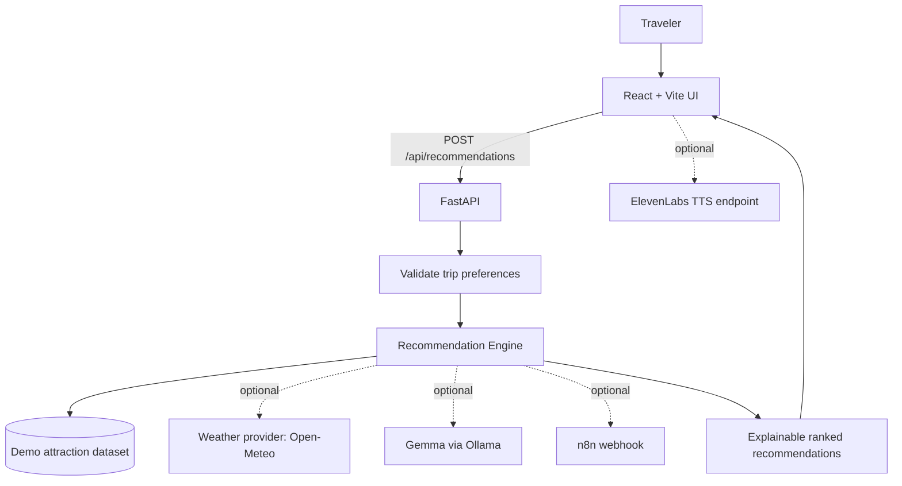

# TripWise — Real-Time Tourism Decision Engine

> **Know where to go, before you go.** Turn uncertain sightseeing into a smarter next-stop decision.

[](LICENSE)
[](https://python.org)
[](https://react.dev)
[](https://fastapi.tiangolo.com)
[](https://docker.com)

TripWise is a hackathon-ready prototype for travelers who need to decide **what to visit now**, not just which places exist. It combines crowd estimates, travel time, weather, daylight, budget, and traveler interests into explainable **GO**, **AVOID**, and **ALTERNATIVE** recommendations.

> **Data honesty:** the included Jaipur dataset is demo data, not a live feed. Crowd values and traffic minutes are explicitly marked as simulated. Plug in verified provider data before presenting them as live. The core recommendation engine works without API keys, so a demo is resilient to venue Wi-Fi and provider outages.

## The problem

Travelers have limited time. Static itineraries cannot react to queues, traffic, changing weather, or a better nearby option. Maps show where things are, but usually leave the decision to the traveler.

## The solution

TripWise ranks nearby attractions with a transparent scoring model and explains the factors behind every recommendation. The interface highlights the recommended next stop, alternatives, crowd levels, estimated travel time, and reasons.

## Features

- **Next-best-place recommendations** with GO / AVOID / ALTERNATIVE actions.
- **Explainable scoring** that weighs crowding, travel time, weather suitability, interests, budget, and daylight.
- **Dynamic itinerary** that can be refreshed as conditions change.
- **Demo mode by default** with seeded Jaipur attractions and simulated values clearly labeled.
- **Provider adapters** for Open-Meteo weather, Gemma through Ollama, ElevenLabs text-to-speech, and an n8n webhook.
- **Health endpoint**, typed request/response schemas, input validation, CORS configuration, and Docker Compose.
- **Graceful degradation:** optional integrations fail safely and the deterministic recommender remains usable.

## Architecture



### Request flow

1. The traveler chooses interests, available time, budget, and current city.
2. The UI sends a validated request to FastAPI.
3. The scoring engine normalizes crowd, travel time, budget fit, weather suitability, and interest match.
4. TripWise returns ranked recommendations and human-readable reasons.
5. Optional AI can rewrite the explanation, but it does not control the numeric ranking. If AI is unavailable, the deterministic explanation is returned.

## Repository layout

```text
tripwise/
├── backend/
│   ├── app/
│   │   ├── main.py              # FastAPI routes
│   │   ├── models.py            # Pydantic contracts
│   │   ├── data.py              # Clearly labeled demo data
│   │   ├── recommender.py       # Explainable ranking algorithm
│   │   └── integrations.py      # Optional weather, Gemma, n8n
│   ├── requirements.txt
│   └── Dockerfile
├── frontend/
│   ├── src/App.jsx
│   ├── src/main.jsx
│   ├── src/styles.css
│   ├── package.json
│   ├── index.html
│   └── Dockerfile
├── workflows/n8n-tripwise-webhook.example.json
├── docs/DEMO_SCRIPT.md
├── .env.example
├── docker-compose.yml
├── setup.sh
├── LICENSE
└── README.md
```

## Quickstart — local development

### Requirements

- Python 3.11+ (3.12 recommended)
- Node.js 20+
- npm

```bash
git clone <your-github-repository-url>
cd tripwise
cp .env.example .env
./setup.sh
```

`setup.sh` creates a Python virtual environment, installs backend dependencies, installs frontend packages, and starts both development servers. Open **http://localhost:5173**. API docs are at **http://localhost:8000/docs**.

If your shell does not allow executing scripts, run `bash setup.sh`.

### Run manually

Backend (from repository root):

```bash
python -m venv .venv
# macOS/Linux
source .venv/bin/activate
# Windows PowerShell: .venv\Scripts\Activate.ps1
pip install -r backend/requirements.txt
uvicorn app.main:app --app-dir backend --reload --host 0.0.0.0 --port 8000
```

Frontend, in a second terminal:

```bash
cd frontend
npm install
npm run dev
```

### Docker Compose

```bash
cp .env.example .env
docker compose up --build
```

- UI: http://localhost:5173
- API: http://localhost:8000
- API docs: http://localhost:8000/docs

## API

### `GET /api/health`

Returns service status and whether optional integrations are configured.

### `GET /api/attractions?city=Jaipur`

Returns the demo attractions. `data_mode` explains that crowd and traffic values are simulated.

### `POST /api/recommendations`

Example request:

```json
{
  "city": "Jaipur",
  "interests": ["history", "architecture", "photography"],
  "available_minutes": 240,
  "budget_inr": 1000,
  "max_crowd_percent": 65,
  "weather": "clear",
  "prefer_outdoors": true
}
```

Example response (shortened):

```json
{
  "city": "Jaipur",
  "data_mode": "simulated_demo_data",
  "generated_at": "2026-01-01T12:00:00Z",
  "recommendations": [
    {
      "attraction_id": "city-palace",
      "name": "City Palace",
      "action": "GO",
      "score": 86.4,
      "crowd_percent": 23,
      "travel_minutes": 18,
      "estimated_visit_minutes": 75,
      "estimated_cost_inr": 300,
      "reasons": ["Crowd estimate is manageable", "Matches your interests"]
    }
  ]
}
```

Scores are relative ranking signals, not probabilities or guarantees. Demo crowd and traffic values are not current measurements.

## Integrations

### Weather — Open-Meteo

Set `OPEN_METEO_ENABLED=true` to enable the optional weather adapter. Open-Meteo does not require an API key for typical non-commercial use. Verify the provider's current terms and usage limits before public or commercial deployment. The prototype's recommendation endpoint accepts an explicit weather context; provider integration can be extended to map a city's coordinates to a forecast.

### Gemma — Ollama

Run Ollama locally, pull a Gemma model, and set `OLLAMA_BASE_URL` / `OLLAMA_MODEL`. The integration is used only to produce a natural-language summary. Numeric ranking remains deterministic. The API gracefully falls back if Ollama is unavailable.

```bash
ollama pull gemma3:4b
```

### ElevenLabs voice

Set `ELEVENLABS_API_KEY` and `ELEVENLABS_VOICE_ID` if you add the optional voice narration endpoint. Keep the key server-side; never expose it in frontend environment variables. The provided backend adapter can synthesize short recommendation summaries when configured.

### n8n

Import `workflows/n8n-tripwise-webhook.example.json` into n8n and set `N8N_WEBHOOK_URL` in the backend environment. The webhook receives a compact, non-sensitive recommendation summary. Do not send precise user location or personal data unless there is a clear need and consent.

## Environment variables

See `.env.example`. Keep `.env` out of Git. Never commit API keys.

## Production hardening checklist

This repository is a functional hackathon MVP, not a claim of a fully audited production service. Before public production use:

- Replace demo crowd/traffic values with licensed, attributable provider data and display timestamps/freshness.
- Add provider timeouts, retry/backoff, quotas, caching, observability, and alerting.
- Restrict CORS to the deployed frontend origin.
- Add authentication/rate limiting if user-specific data or costly integrations are exposed.
- Add tests, CI, dependency scanning, and secret scanning.
- Add persistence only if required; document retention and deletion policies.
- Confirm map, weather, voice, and model provider terms and attribution requirements.
- Do not market sample crowd levels as live data.

## Hackathon demo script

See [`docs/DEMO_SCRIPT.md`](docs/DEMO_SCRIPT.md) for a 90-second demo narrative and judge talking points.

## Roadmap

- [x] Explainable baseline ranking engine
- [x] Responsive interactive dashboard
- [x] Demo mode with clear data labels
- [x] Docker and one-command local setup
- [ ] Live provider-backed crowd/traffic data with timestamps
- [ ] Map view and route optimization
- [ ] Event and daylight integration
- [ ] User feedback loop and evaluation dataset

## Contributing

Issues and pull requests are welcome. Keep demo data clearly marked, add tests for scoring changes, and document provider limitations.

## License

MIT — see [`LICENSE`](LICENSE).
